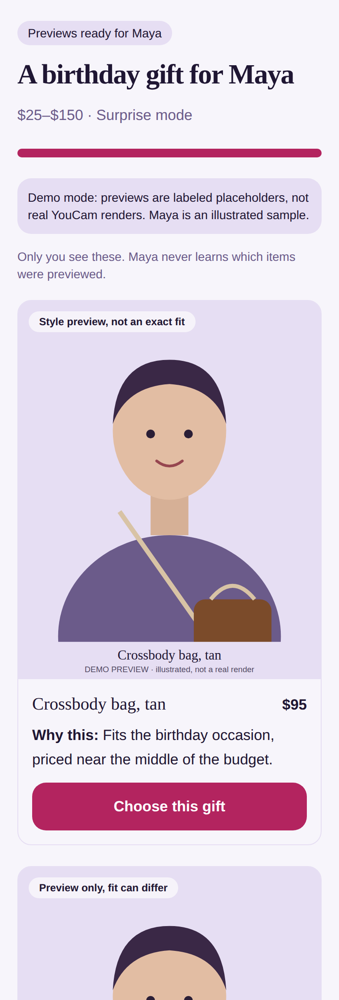
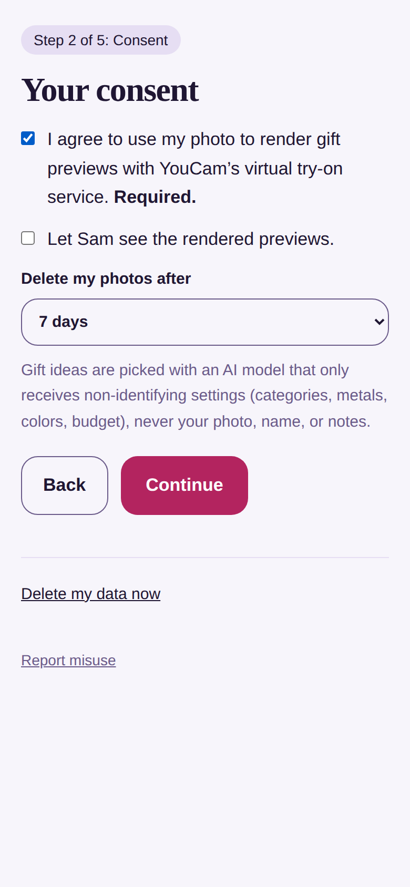
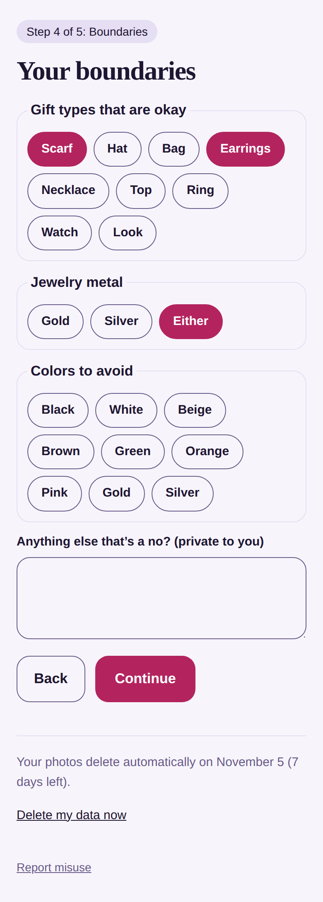
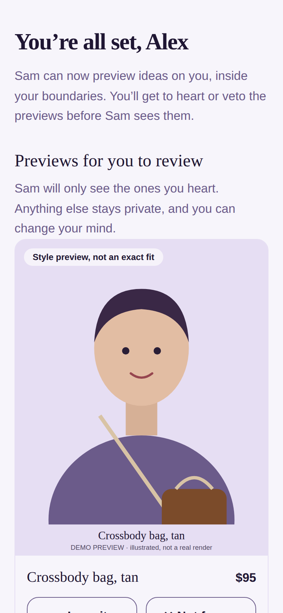
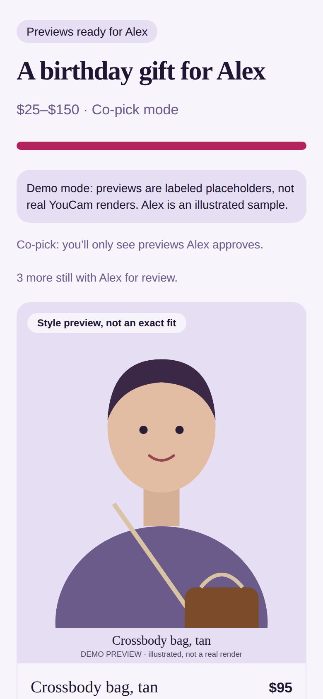
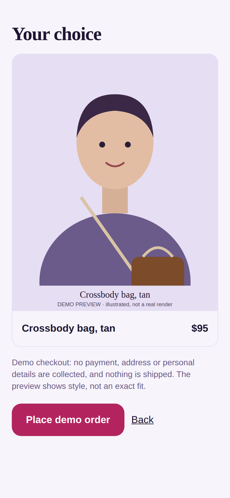
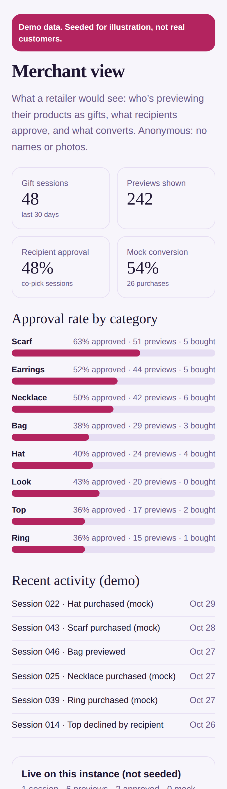
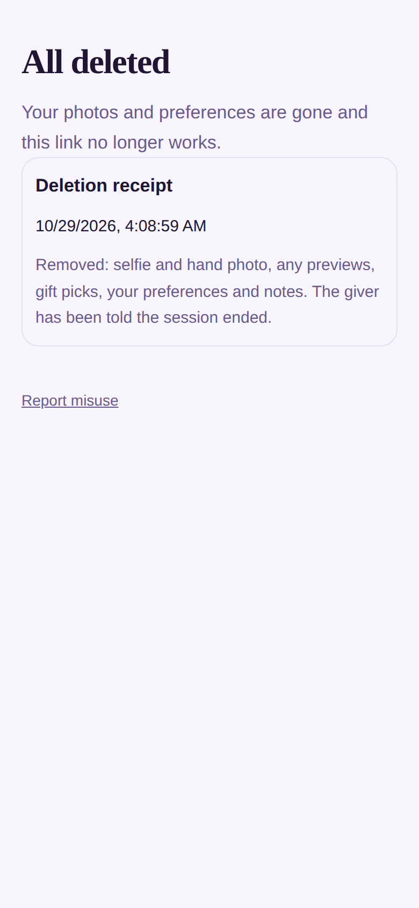
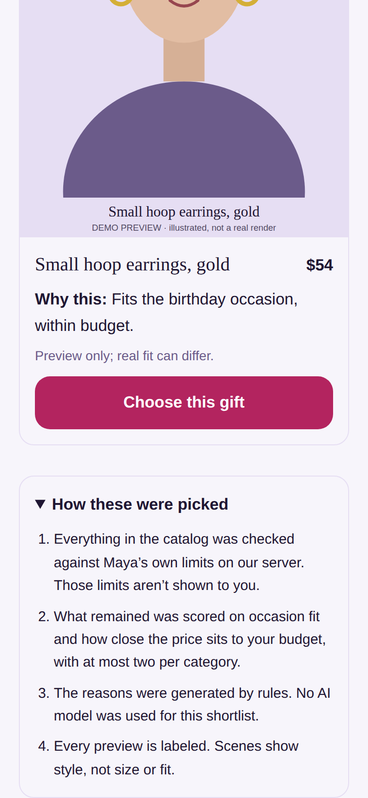
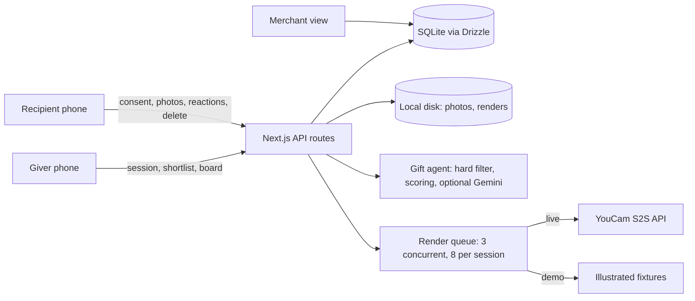

# GiftFit

**See the gift on them before you buy it, without spoiling the surprise.**

A consent-first, two-sided gifting app: the giver sends a private link, the recipient shares one selfie and sets their limits, and GiftFit previews real candidate gifts on them using YouCam's virtual try-on APIs. A gift agent ranks the options by occasion, budget and the recipient's boundaries, with a plain-language reason and an honest caveat for every pick.



> Built for the YouCam API hackathon. **Runs with no API keys** in demo mode (illustrated previews, clearly labeled). Live YouCam rendering is implemented; [Known limitations](#known-limitations) is explicit about what has and hasn't been exercised against the real service.

## Quickstart

Requirements: **Node 20+** and **pnpm 9+** (`npm i -g pnpm`).

### Demo mode (no keys needed)

```bash
git clone <repo-url> && cd giftfit
nvm use                    # or install the Node version in .nvmrc
cp .env.example .env
pnpm i && pnpm db:push && pnpm seed && pnpm dev
# open http://localhost:3000, then tap "Try the demo"
```

Verify it works: with the server running, `pnpm test:smoke` runs 20 end-to-end checks (setup, consent, renders, co-pick, checkout, delete-all).

### Docker

```bash
docker compose up        # http://localhost:3000, data persists in a named volume
```

### Live mode (real YouCam renders)

```bash
# .env
DEMO_MODE=false
YOUCAM_API_KEY=...
APP_URL=https://your-public-url     # YouCam fetches product images from this URL, so it must be reachable
GEMINI_API_KEY=...                  # optional: AI-written reasons (free key from Google AI Studio)
GIFT_AGENT_MODEL=...                # a current Flash / Flash-Lite model ID from AI Studio
```

Restart. Live rendering also needs product photos vetted against each endpoint's image spec (`image_spec_ok` in `src/db/seed.ts`); the bundled catalog uses placeholder tiles, so replace them with licensed photos (credited in `ASSETS_LICENSES.md`) before live use.

### Troubleshooting

- **`ERR_PNPM_IGNORED_BUILDS`**: run `pnpm approve-builds --all`. The repo ships `pnpm-workspace.yaml` / `package.json` allowlists that normally make this unnecessary (tested on pnpm 9, 10 and 12).
- **`better-sqlite3` binding not found**: `pnpm rebuild better-sqlite3` (needs a C++ toolchain only if no prebuilt binary matches your platform).
- **Reset everything**: `pnpm db:reset` (also delete files in `storage/`).

## How it works

1. **Giver** creates a session (occasion, budget, *Surprise* or *Co-pick*) and shares a private, expiring invite link.
2. **Recipient** opens the link and goes through: consent (rendering and sharing are separate choices, plus auto-delete after 1/7/30 days) → selfie (and an optional hand photo for rings and watches) → boundaries (gift types, metal, colors to avoid, private no-gos) → what to share.
3. **Gift agent** filters the catalog by the recipient's limits *on the server*, scores what's left, and (optionally) asks Gemini to re-rank and write reasons.
4. **Renders** are queued (3 at a time, 8 per session) and appear on the giver's board as they finish, each labeled *Style preview, not an exact fit* or *Preview only, fit can differ*.
5. **Surprise mode:** the recipient never sees which items were previewed. **Co-pick mode:** the recipient hearts or vetoes previews of themselves, and the giver sees only the hearted ones.
6. **Mock checkout** records a demo purchase (no payment or personal data). The **merchant view** (`/merchant`) shows an anonymous gifting funnel.
7. The recipient can **delete everything at any time** and gets a receipt; the giver's session ends.

| Recipient consent | Boundaries | Co-pick review |
|---|---|---|
|  |  |  |

| Giver sees approvals | Mock checkout | Merchant view (seeded) | Delete receipt |
|---|---|---|---|
|  |  |  |  |

The giver's **How these were picked** panel (the recipient's limits are never shown to the giver):



## YouCam APIs used

All calls go through `src/lib/youcam.ts` (upload → create task → poll → download). Per-category request bodies live in `src/lib/render/adapters.ts`; the queue is `src/lib/render/queue.ts`.

| Category | Endpoint | Preview type | Live status |
|---|---|---|---|
| Scarf | `POST /s2s/v2.0/task/scarf` | styled scene | **Enabled by default.** Body per the YouCam scarf docs (`src_file_id`, `ref_file_url`, `style`). |
| Clothes (top) | `/s2s/v2.0/task/cloth-v4` | overlay | Behind `YOUCAM_EXPERIMENTAL=true`: body fields unverified |
| Earrings | `/s2s/v2.0/task/2d-vto/earring` | overlay | Behind `YOUCAM_EXPERIMENTAL=true`: body fields unverified |
| Necklace | `/s2s/v2.0/task/2d-vto/necklace` | overlay | Behind `YOUCAM_EXPERIMENTAL=true`: body fields unverified |
| Bag | `/s2s/v2.0/task/bag` (+ `/file/bag`) | styled scene | Behind `YOUCAM_EXPERIMENTAL=true`: body fields unverified |
| Ring / Watch | `/s2s/v2.0/task/2d-vto/ring`, `.../watch` | overlay (hand photo) | Behind `YOUCAM_EXPERIMENTAL=true`: body fields unverified |
| Hat, Makeup look | none confirmed / needs template id | | Demo mode only |

Unverified adapters are **off by default** so the app never spends credits on guessed request bodies. The live code path is tested against `scripts/mock-youcam.mjs`, a local stand-in built from the documented shapes (it is *not* the real service). To use it: `node scripts/mock-youcam.mjs`, then `DEMO_MODE=false YOUCAM_API_KEY=testkey YOUCAM_BASE_URL=http://localhost:4010`.

## Architecture



Key decisions:

- **The server enforces every limit.** The agent proposes; `src/lib/boundaries.ts` decides. Category, budget, avoided colors, metal, hand-photo and live-adapter checks run on every render request, whatever the UI or agent says.
- **Stateless queue.** Render state lives in the database; any request can advance it. Polling the list also finishes abandoned renders, so a closed tab can't hold a slot forever.
- **SQLite + local disk** so there is nothing external to run. One instance, one volume.
- **Honest labeling is server-side**: caveats are forced to mention preview limits (and ring size) regardless of what a model writes.

## Privacy and consent model

- Rendering consent and sharing consent are separate. Without sharing consent the giver sees nothing.
- Photos are stored only on the server's disk, expire after the recipient's chosen 1/7/30 days, and are re-encoded in the browser (EXIF/GPS stripped) and validated by magic bytes on the server. Photos are never sent to the LLM.
- **Gemini receives only**: the occasion, a budget range, and candidate product metadata. No photos, names, notes, or the recipient's limits (candidates are already filtered by them). Reasons that echo a limit (for example "avoids orange") are discarded before the giver sees them. Free-tier Gemini usage may be covered by different data-use terms than paid usage; check Google's current terms, which is why nothing identifying is sent.
- The giver never sees which limits applied. In co-pick mode they see only items the recipient hearted.
- Invite tokens are random, stored only as HMAC hashes, and expire after 14 days. Set `INVITE_TOKEN_SECRET` in production (auto-generated and persisted in Docker/Fly if unset).
- **Delete my data** removes photos, renders, picks, preferences and live analytics events immediately, and deactivates the link. Seeded demo analytics are unaffected.
- Merchant analytics are anonymous: session id, item id and event type only.

## Demo mode

`DEMO_MODE=true` (default) runs the same queue, polling and UI without calling YouCam. Previews are **illustrations of an illustrated sample person**, generated by `scripts/gen-demo-fixtures.py`, and labeled "DEMO PREVIEW · illustrated, not a real render". They are never shown as real renders. The "Try the demo" button creates a ready session for the sample recipient so you can skip the invite step. Merchant numbers are seeded demo data, labeled as such.

## Known limitations

- **Live rendering has been exercised only against a local mock** (`scripts/mock-youcam.mjs`), not the real YouCam service, so no real renders are included. The *Live status* column above reflects documented request shapes, not confirmed live results.
- Previews show style, not exact fit. Rings and watches can't confirm size.
- Hat and makeup-look previews exist only in demo mode.
- The Gemini path is tested against a mock server, not the real API.
- Undertone scoring exists in code but is inactive: the color-profile analysis isn't wired up.
- Giver access is a capability URL (the unguessable session id), not an account. There is no rate limiting or abuse detection, and photos are not encrypted at rest.
- A giver can infer how many previews a recipient declined in co-pick mode (proposed minus approved minus pending).
- A failed render shows a message but no automatic replacement is chosen.
- Tested in headless Chromium at phone size and in Node. Not tested on iOS Safari or Android, and no formal accessibility audit (semantic HTML, focus styles, `aria-pressed` and live regions are in place).
- Single instance: SQLite and local disk mean one machine, one volume.

## Testing notes

```bash
pnpm typecheck
pnpm test:smoke          # needs a running server in DEMO_MODE (pnpm dev)
pnpm check:secrets       # quick credential-pattern scan before publishing
pnpm db:reset            # wipe and re-seed the database
```

Mock servers for the optional integrations: `scripts/mock-youcam.mjs` (port 4010) and `scripts/mock-gemini.mjs` (port 4020, `MODE=ok|429once|429|badjson|badids|badschema|leak|slow`).

## Deploy

`fly.toml` is included (volume at `/data`, health check on `/api/health`). See the comments at the top of the file. Set `APP_URL` to your public URL. The deployed app runs in demo mode unless you set `DEMO_MODE=false` and `YOUCAM_API_KEY`. Docker runs as root so it can write to a fresh volume.

## License and credits

MIT, see [`LICENSE`](LICENSE). Asset and third-party credits are in [`ASSETS_LICENSES.md`](ASSETS_LICENSES.md). No brand logos or trademarks are used.
